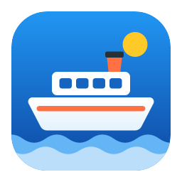
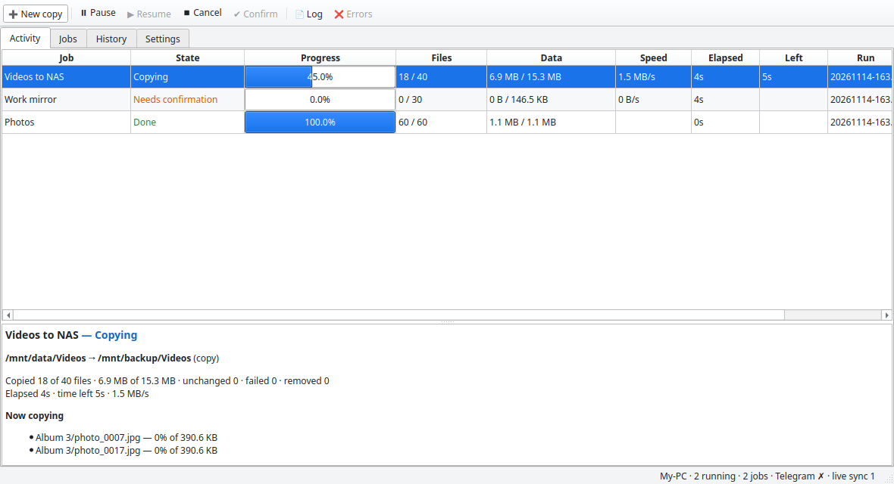
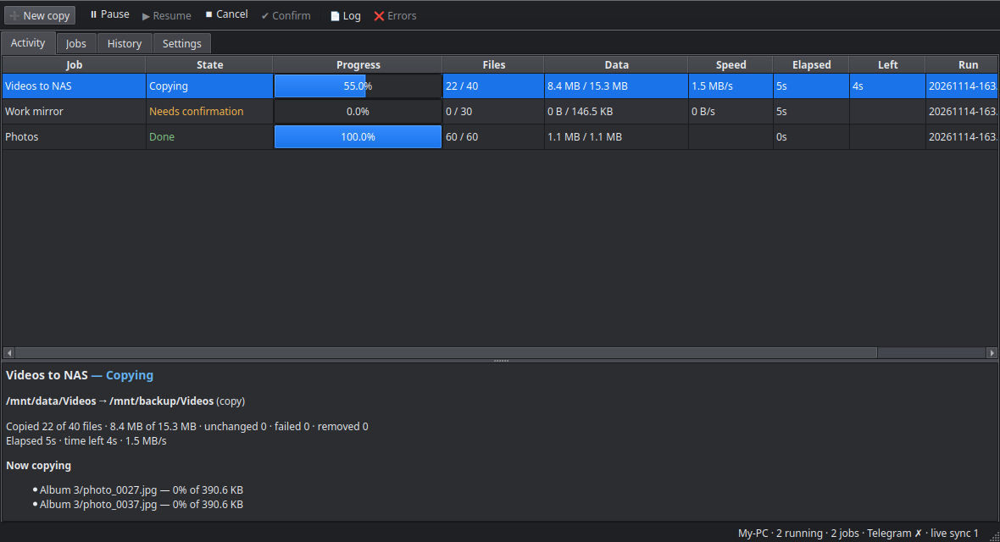

<p align="center"></p>

<h1 align="center">Ferry</h1>

**Ferry carries your files from one place to another, safely.**

Think of a ferry boat: files get on at one side (the **source**) and get off at the other side (the
**destination**). Ferry can do it once, every night, or every time a file changes. It remembers where it stopped,
it never throws your old files away unless you tell it to, and it can send you messages on Telegram about how
it's going.

It works on **Windows, macOS and Linux**, you **don't need to be an administrator**, and you don't even need to
install it: just unzip and double-click.



<details>
<summary>🌙 It has a dark mode too (and can follow your computer's setting)</summary>


</details>

---

## What can Ferry do?

| | |
|---|---|
| 📋 **Copy** | Copy new and changed files. Files that are already there are skipped, so the second time is super fast. |
| 🪞 **Mirror** | Make the destination look *exactly* like the source (a perfect twin). |
| 📦 **Move** | Copy, then remove the files from the source. |
| ⏰ **Schedule** | "Do this every night at 2:00" — Ferry remembers and does it by itself. |
| 👀 **Live sync** | Watch a folder; every change is copied within seconds. |
| 🛟 **Safe by default** | Files that would be replaced or deleted are moved to a `.ferry-archive` folder instead. You can also make Ferry ask you first. |
| 🔁 **Never starts over** | Computer crashed or restarted? Ferry continues where it stopped, even in the middle of a huge file. |
| 🌍 **Anywhere** | Disks, USB sticks, network shares, other computers over SSH (SFTP), and 70+ clouds (Google Drive, OneDrive, Dropbox, S3…). |
| 🔐 **Permissions too** | Keeps dates, attributes, Windows (NTFS) permissions, Linux/macOS permissions, links and extra attributes. |
| 📱 **Telegram bot** | Ask *"how far along is it? how long is left?"* from your phone, pause or start jobs, and get a message when it's done. |
| 🖥 **Three ways to use it** | A desktop app, a full-screen terminal app for servers, and simple commands. They all show the same jobs. |
| 🧰 **Robocopy friendly** | Already know robocopy? `ferry robo C:\src D:\dst /MIR` just works. |

---

## Start in 3 steps

### 1. Download

Go to the **[Releases page](https://github.com/arikpinhasov1998/Ferry/releases/latest)** and download the zip for
your computer:

| Your computer | Download |
|---|---|
| Windows | `ferry-…-windows-x64.zip` |
| Mac with Apple chip (M1, M2, M3, M4…) | `ferry-…-macos-arm64.zip` |
| Mac with Intel chip | `ferry-…-macos-x64.zip` |
| Linux (most PCs) | `ferry-…-linux-x64.zip` |
| Linux on ARM (Raspberry Pi 4/5 64-bit, ARM servers) | `ferry-…-linux-arm64.zip` |

> Not sure which Mac you have? Click the Apple menu → **About This Mac**. "Chip: Apple M…" means Apple chip.

### 2. Unzip it anywhere

A folder on your desktop, your Documents, or a USB stick — anywhere is fine. Inside you'll find:

- **`ferry-gui`** — the desktop app (the one with windows and buttons) 👈 start with this one
- **`ferry`** — the command tool (for typing commands, servers, and the terminal app)

### 3. Open the desktop app

- **Windows:** double-click `ferry-gui.exe`. If a blue "Windows protected your PC" box appears, click
  **More info → Run anyway** (it appears because Ferry is new and not signed by a company).
- **Mac:** right-click (or Control-click) `ferry-gui` → **Open** → **Open**. You only need to do this the
  first time.
- **Linux:** double-click `ferry-gui`, or run `./ferry-gui` in a terminal. (If it won't start: `chmod +x ferry ferry-gui`.)

---

## Your first copy (1 minute)

1. Click **➕ New copy**.
2. **Source:** click **Browse…** and pick the folder you want to copy (for example your Pictures).
3. **Destination:** click **Browse…** and pick where the copy should go (for example your USB disk).
4. Leave everything else as it is and click **Run now**.

Watch the progress bar fill up. 🎉 That's it! Run it again tomorrow and Ferry only copies what's new.

**Same thing with a command** (open a terminal in the Ferry folder):

```bash
ferry copy "C:\Users\me\Pictures" "E:\Backup\Pictures"
```

On macOS/Linux use `./ferry` and paths like `~/Pictures /media/usb/Pictures`.

---

## I want to…

| I want to… | Desktop app | Command |
|---|---|---|
| Copy a folder once | **New copy** → Run now | `ferry copy SRC DST` |
| Make a perfect twin of a folder | New copy → Mode **Mirror** | `ferry mirror SRC DST` |
| See what *would* happen first | tick **Dry run** | add `--dry-run` |
| Back up every night | New copy → **Schedule** `0 2 * * *` → **Save job** | `ferry job add NAME SRC DST --schedule "0 2 * * *"` |
| Copy changes as they happen | tick **Live sync** → Save job | `ferry job add NAME SRC DST --watch` |
| Be asked before anything is deleted | Replaced/extra files → **Ask me before deleting/overwriting** | add `--delete-mode confirm` |
| Pause / continue / stop | **Pause**, **Resume**, **Cancel** buttons | `ferry pause all`, `ferry resume all`, `ferry cancel NAME` |
| See which files failed | **Errors** button | `ferry errors NAME` |
| Keep Ferry running after login | Settings → **Install / start at login** | `ferry service install` |
| Open Ferry from the Start menu / app menu | Settings → **Add to Start menu / app menu** | `ferry shortcut install` |
| Control it from my phone | Settings → **Set up bot…** | `ferry telegram setup` |
| Use it on a server without a screen | — | `ferry tui` |
| Switch light / dark mode | Settings → **Theme** | in `ferry tui` press `t` |

---

## Learn everything

The **[📖 User Guide](docs/GUIDE.md)** explains every button, every command and every option, step by step,
with examples. Good places to start:

- [The big ideas in 2 minutes](docs/GUIDE.md#1-the-big-ideas) (source, destination, copy, mirror, jobs…)
- [The desktop app, button by button](docs/GUIDE.md#3-the-desktop-app)
- [Keeping your files safe](docs/GUIDE.md#6-keeping-your-files-safe) (archive, ask first, dry run, getting files back)
- [Schedules and live sync](docs/GUIDE.md#7-saved-jobs-schedules-and-live-sync)
- [The Telegram bot](docs/GUIDE.md#14-the-telegram-bot)
- [Copying to servers and clouds](docs/GUIDE.md#11-other-computers-and-clouds)
- [For robocopy users](docs/GUIDE.md#15-for-robocopy-users)
- [Something went wrong?](docs/GUIDE.md#17-troubleshooting) · [Cheat sheet](docs/GUIDE.md#19-cheat-sheet)

---

## For developers

```bash
python -m venv .venv
.venv/bin/pip install -e ".[gui,dev]"     # Windows: .venv\Scripts\pip ...
.venv/bin/python -m pytest -q             # tests (includes an in-process SFTP server)
.venv/bin/python packaging/build.py       # builds dist/ferry and dist/ferry-gui for this OS
```

Python 3.10+. CI (`.github/workflows/build.yml`) tests on Windows, Linux and macOS and builds the zips for all
five platforms; pushing a `v*` tag publishes a GitHub release.

Code map: `engine.py` (planning + copying), `backends/` (local, SFTP, rclone), `metadata.py` (ACLs, xattrs…),
`jobs.py` (jobs, runs, history, resume), `daemon.py` + `api.py` (background service and its local API),
`telegram.py`, `scheduler.py`, `watcher.py`, `cli.py` + `robocopy.py`, `tui.py`, `gui.py`, `service.py`.

Issues and pull requests are welcome — please run the tests first.

## License

[MIT](LICENSE) © 2026 Arik Pinhasov. The ready-made downloads include third-party libraries under their own
licenses, including Qt/PySide6 (LGPLv3) in `ferry-gui`, paramiko (LGPL), watchdog, textual and xxhash.
