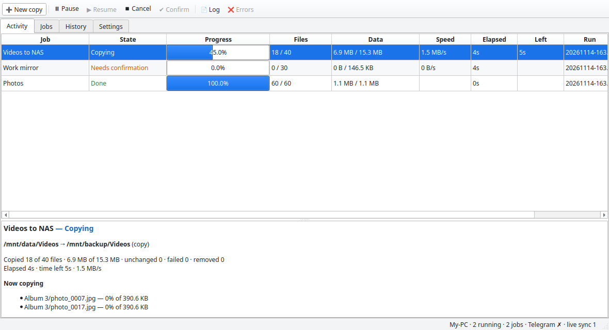
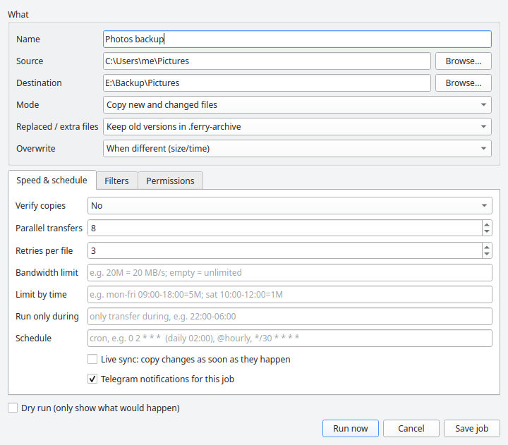
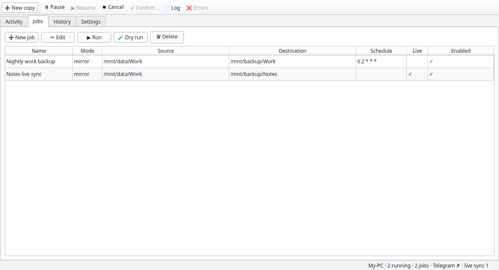
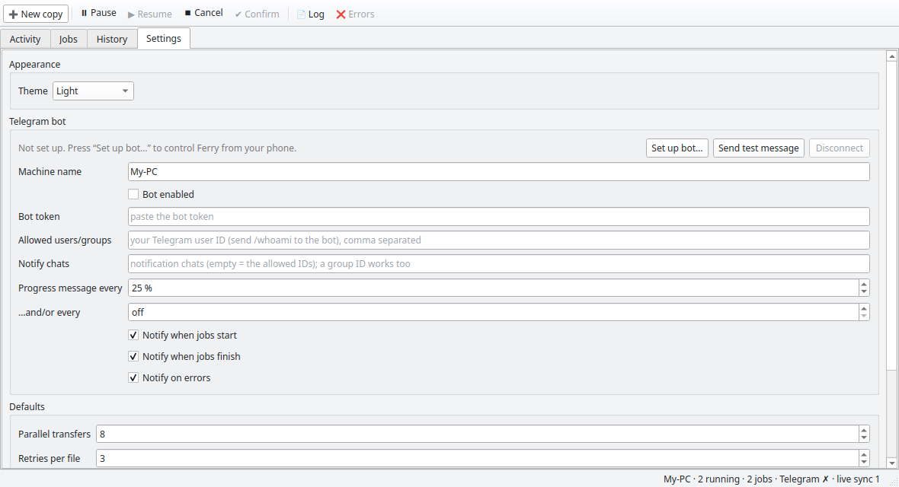
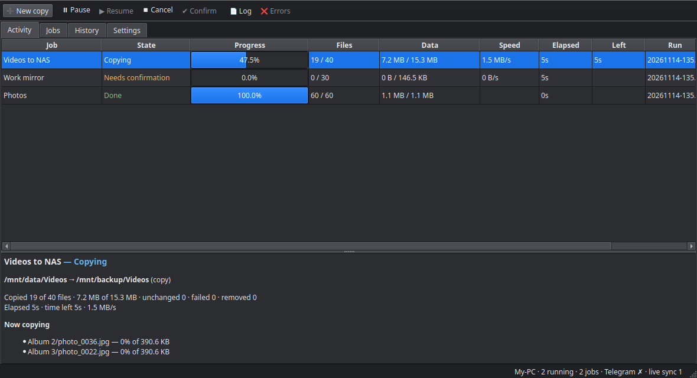
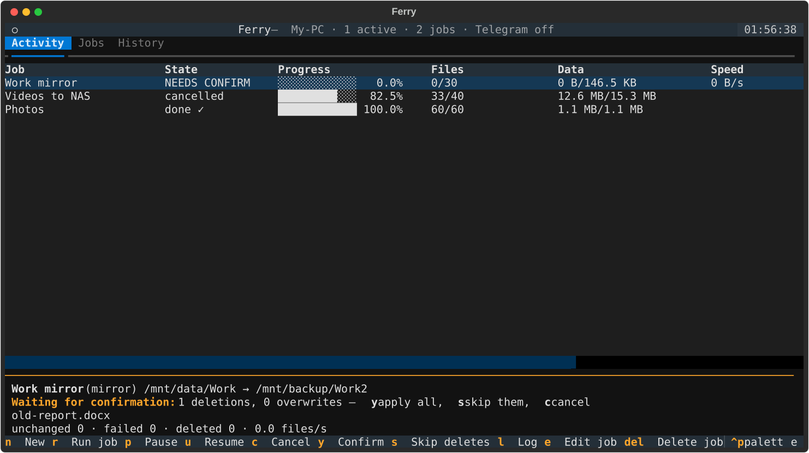
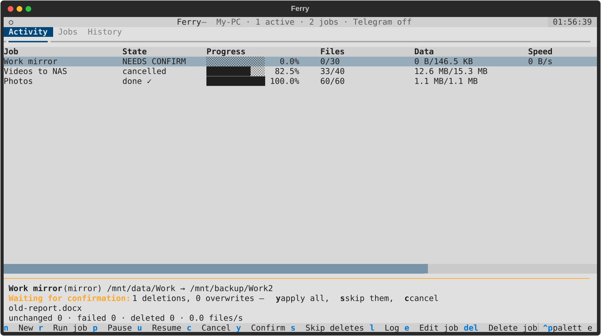
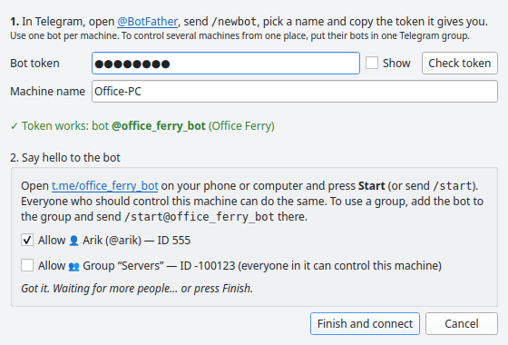

# The Ferry User Guide 📖

This guide explains **everything** Ferry can do, from your very first copy to the most advanced options. It
starts very simple and gets more detailed as you go. You don't have to read it all — jump to what you need.

> **How to read the examples**
> Text in a grey box like `ferry copy A B` is something you type in a terminal (the black window with text).
> On **Windows** type `ferry`. On **macOS and Linux** type `./ferry` when you are inside the Ferry folder
> (or just `ferry` if you put it in your PATH — see [Installing](#2-installing)).
> Paths look different on each system: Windows `C:\Users\me\Pictures`, macOS `/Users/me/Pictures`,
> Linux `/home/me/Pictures`. `~` is a shortcut for "my home folder" on macOS and Linux.

## Contents

1. [The big ideas](#1-the-big-ideas)
2. [Installing](#2-installing)
3. [The desktop app](#3-the-desktop-app)
4. [The terminal app (for servers)](#4-the-terminal-app-for-servers)
5. [Commands](#5-commands)
6. [Keeping your files safe](#6-keeping-your-files-safe)
7. [Saved jobs, schedules and live sync](#7-saved-jobs-schedules-and-live-sync)
8. [Choosing which files (filters)](#8-choosing-which-files-filters)
9. [Speed, bandwidth and quiet hours](#9-speed-bandwidth-and-quiet-hours)
10. [Checking that copies are perfect](#10-checking-that-copies-are-perfect)
11. [Other computers and clouds](#11-other-computers-and-clouds)
12. [Permissions, dates and links](#12-permissions-dates-and-links)
13. [The background helper (service)](#13-the-background-helper-service)
14. [The Telegram bot](#14-the-telegram-bot)
15. [For robocopy users](#15-for-robocopy-users)
16. [Settings file](#16-settings-file)
17. [Troubleshooting](#17-troubleshooting)
18. [Questions people ask](#18-questions-people-ask)
19. [Cheat sheet](#19-cheat-sheet)
20. [Words you'll see](#20-words-youll-see)

---

## 1. The big ideas

Imagine you have a toy box (**source**) and you want the same toys in a second box (**destination**).

| Word | What it means | Example |
|---|---|---|
| **Source** | Where the files are now. Ferry only *reads* from here (except in Move mode). | `C:\Users\me\Pictures` |
| **Destination** | Where the files should go. | `E:\Backup\Pictures` |
| **Copy** | Put every toy that's new or changed into the second box. Toys that are already there are left alone. | Daily backup |
| **Mirror** | Make the second box *exactly* like the first. If a toy is gone from the first box, it's taken out of the second one too. | Keep a perfect twin |
| **Move** | Put the toys in the second box, then take them out of the first. | Clear a full disk |
| **Run** | One time Ferry does the work. | "This morning's run" |
| **Job** | A saved recipe: source + destination + options + a name. Run it whenever you want, or on a schedule. | "Nightly backup" |
| **Dry run** | Pretend. Ferry tells you what it *would* do, and changes nothing. | Try before you mirror |
| **Archive** | Ferry's safety net: files that would be replaced or deleted go into a `.ferry-archive` folder instead of the bin. | Get yesterday's version back |
| **Background helper** (service) | A small invisible part of Ferry that does the actual work, so jobs keep going when you close the window. | |

**How Ferry decides what to copy:** a file is copied when it's missing in the destination or when it's
*different* there (another size or another "last changed" time). Everything else is counted as "unchanged" and
skipped. That's why the second run is so fast.

**Ferry never starts over.** It writes its plan to disk first. If the computer restarts in the middle, Ferry
continues where it stopped — even halfway through a 50 GB file.

---

## 2. Installing

### Download

From the **[Releases page](https://github.com/arikpinhasov1998/Ferry/releases/latest)** download one zip:

| Computer | File |
|---|---|
| Windows 10/11 | `ferry-<version>-windows-x64.zip` |
| Mac with Apple chip | `ferry-<version>-macos-arm64.zip` |
| Mac with Intel chip | `ferry-<version>-macos-x64.zip` |
| Linux PC | `ferry-<version>-linux-x64.zip` |
| Linux ARM (Raspberry Pi 64-bit…) | `ferry-<version>-linux-arm64.zip` |

Unzip it into any folder. Inside:

| File | What it is |
|---|---|
| `ferry-gui` (`ferry-gui.exe`, `ferry-gui.app` on Mac) | The desktop app with windows and buttons |
| `ferry` (`ferry.exe`) | The command tool: commands, the terminal app (`ferry tui`) and the background helper |
| `PORTABLE.txt` | A short note about portable mode |

No installer and **no administrator rights** are needed.

### First start

- **Windows:** double-click `ferry-gui.exe`. If you see *"Windows protected your PC"*, click **More info** →
  **Run anyway**. This happens because Ferry isn't signed by a company; it only shows once.
- **macOS:** right-click `ferry-gui` → **Open** → **Open**. For the command tool, the first time run it from
  Terminal; if macOS blocks it, open **System Settings → Privacy & Security** and click **Allow Anyway**.
- **Linux:** run `./ferry-gui`. If it says "permission denied": `chmod +x ferry ferry-gui`.

### Optional: type `ferry` from anywhere (PATH)

- **Windows:** Start → type "environment" → *Edit environment variables for your account* → `Path` →
  **Edit** → **New** → paste the Ferry folder → OK. Open a new terminal.
- **macOS/Linux:** `mkdir -p ~/.local/bin && cp ferry ~/.local/bin/` (and make sure `~/.local/bin` is in your PATH).

### Optional: put Ferry in your Start menu / app menu

So you can open Ferry like any other program (with its icon):

- **Windows / Linux:** in the desktop app go to **Settings → Shortcut → Add to Start menu** (Windows) or
  **Add to app menu** (Linux). Or run `ferry shortcut install`. `ferry shortcut uninstall` removes it again.
- **macOS:** drag `ferry-gui.app` into your **Applications** folder. It already has its icon, so it shows up in
  Launchpad, Spotlight and the Dock.

On Linux this also makes the taskbar show Ferry's icon instead of a generic one.

### Portable mode (on a USB stick)

Make an **empty folder named `ferry-data`** next to the `ferry` files. From then on Ferry keeps *all* its
settings, jobs, history and logs inside that folder, so you can carry everything on a USB stick and use it on
any computer.

Without `ferry-data`, settings are kept in your user profile:

| System | Settings folder |
|---|---|
| Windows | `%LOCALAPPDATA%\Ferry` (e.g. `C:\Users\me\AppData\Local\Ferry`) |
| macOS | `~/Library/Application Support/Ferry` |
| Linux | `~/.config/ferry` |

`ferry config path` always tells you which folder is used. (Advanced: the `FERRY_HOME` environment variable
chooses any folder.)

### Updating

Download the new zip and replace the old `ferry` and `ferry-gui` files. Your jobs and settings stay where they
are. If the background helper is running, stop it first: `ferry daemon stop` (it starts again by itself).

---

## 3. The desktop app

Open `ferry-gui`. The window has a **toolbar** at the top, four **tabs**, and a **status line** at the bottom.



### Toolbar

| Button | What it does |
|---|---|
| ➕ **New copy** | Opens the copy window (below) to start a copy or save a job |
| ⏸ **Pause** | Pauses the selected run (files in progress finish their current piece) |
| ▶ **Resume** | Continues a paused run |
| ■ **Cancel** | Stops the selected run. What was copied stays copied. |
| ✔ **Confirm** | Answers a run that is waiting for your OK (see [Ask me first](#ask-me-first-confirm)) |
| 📄 **Log** | Shows the full diary of the selected run: every file copied, skipped or failed |
| ❌ **Errors** | Shows only the files that failed and why |

### Activity tab

Every run that is happening now, plus the latest finished ones. Columns: job name, state, progress bar, files
done/total, data done/total, speed, time elapsed, **time left**, and the run's ID.

**The progress bar:** before copying starts, while Ferry is *starting* and *scanning* the folders to find out
what to copy, the bar moves back and forth because the total isn't known yet; the Files column counts how many
files were found so far. As soon as copying begins, the bar shows the real percentage. While a run waits for your
OK the bar stands still with "Waiting for your OK". (The terminal app, the command line and Telegram behave the
same way.)

Click a run to see details underneath: where from and to, how many files were copied, unchanged, failed and
removed, the **elapsed time and time left**, and which files are being copied right now.

**States you may see:** Starting → Scanning (looking at the folders) → Copying → Cleaning up → Finishing →
**Done**. Also: **Needs confirmation** (waiting for you), **Done with errors** (some files failed — click
Errors), **Failed**, **Cancelled**, **Interrupted** (the computer stopped; it will continue by itself).

### The copy window ("New copy" / "New job" / "Edit")



**Top part — "What":**

| Field | Explained |
|---|---|
| **Name** | Any name, like "Photos backup". Needed only to *save* it as a job. |
| **Source** | The folder to copy from. Type it or click **Browse…**. Can also be a network share, `sftp://…` or a cloud `remote:path` ([section 11](#11-other-computers-and-clouds)). |
| **Destination** | Where to copy to. Created if it doesn't exist. |
| **Mode** | *Copy new and changed files* / *Mirror (make identical)* / *Move (delete from source after copy)* |
| **Replaced / extra files** | What happens to files in the destination that get overwritten or removed: *Keep old versions in .ferry-archive* (safest, default) / *Ask me before deleting/overwriting* / *Delete directly* |
| **Overwrite** | When an existing destination file gets replaced: *When different (size/time)* (default) / *Only when newer* / *When content differs (checksum)* (slow but exact) / *Always* / *Never (only new files)* |

**Tab "Speed & schedule":**

| Field | Explained |
|---|---|
| **Verify copies** | *No* / *xxHash (fast)* / *SHA-256*. Reads each copied file back and compares fingerprints. |
| **Parallel transfers** | How many files are copied at the same time (default 8). More helps with many small files or slow networks. |
| **Retries per file** | How many times to try again if a file fails (default 3). |
| **Bandwidth limit** | Maximum speed, e.g. `20M` = 20 MB per second. Empty = as fast as possible. |
| **Limit by time** | Different limits at different times, e.g. `mon-fri 09:00-18:00=5M` (slow during work hours). Separate several with `;`. |
| **Run only during** | Copy only in these hours, e.g. `22:00-06:00`. Outside them the run waits patiently. |
| **Schedule** | When a saved job runs by itself, e.g. `0 2 * * *` = every day at 02:00 ([how schedules work](#schedules)). |
| **Live sync** | Watch the source and copy changes within seconds. |
| **Telegram notifications for this job** | Send messages about this job to Telegram. |

**Tab "Filters":** which files to include/skip — see [section 8](#8-choosing-which-files-filters).

**Tab "Permissions":** what extra information to copy — see [section 12](#12-permissions-dates-and-links).

**Bottom:** tick **Dry run** to only see what would happen. Then:

- **Run now** — start it once (if you gave it a name, it's not saved; use Save job for that)
- **Save job** — save it in the Jobs tab (and run it on its schedule or with live sync)
- **Cancel** — close without doing anything

### Jobs tab



Your saved jobs. Buttons: **New job**, **Edit**, **Run**, **Dry run** (see what it would do), **Delete** (removes
the job, never your files). Double-click a job to edit it. The columns show the mode, source, destination,
schedule and whether live sync is on.

### History tab

Every finished run: when, which job, the result, how many files and how much data, how long it took, and how
many failed. Select one and use **Log** or **Errors** for the details.

### Settings tab



| Section | What you can do |
|---|---|
| **Appearance → Theme** | **Match system** (follows your computer's light/dark setting, even when it changes), **Light** or **Dark**. Applied immediately. |
| **Telegram bot** | Connect and configure the bot — see [section 14](#14-the-telegram-bot) |
| **Defaults** | Parallel transfers and retries for new copies; *Resume interrupted runs when the service starts* |
| **Background service** | **Install / start at login** so Ferry runs after every login; **Remove** to undo |
| **Shortcut** (Windows/Linux) | **Add to Start menu / app menu** so you can open Ferry with its icon like any program; **Remove** to undo |

Press **Save settings** at the bottom after changing things (the theme saves by itself). **Undo changes** puts
back what's saved.

### Dark mode



### The tray icon

Closing the window does **not** stop your copies: Ferry hides in the tray (next to the clock). Right-click the
tray icon for **Open Ferry**, **New copy…**, **Pause all**, **Resume all** and **Quit window** (the background
helper keeps working). You get a small pop-up when a run finishes or needs your OK.

---

## 4. The terminal app (for servers)

For computers without a screen (servers, Raspberry Pi over SSH), run:

```bash
ferry tui
```



It shows the same **Activity**, **Jobs** and **History** tabs. Use the arrow keys to select, and these keys:

| Key | Does |
|---|---|
| `n` | New copy / job |
| `r` | Run the selected job |
| `e` | Edit the selected job |
| `Delete` | Delete the selected job (not the files) |
| `p` / `u` | Pause / resume (un-pause) the selected run |
| `c` | Cancel the selected run |
| `y` | Confirm: apply all deletions and overwrites |
| `s` | Confirm, but **skip** deletions and overwrites |
| `l` | Show the log |
| `t` | Change theme: match terminal → light → dark |
| `Tab` / mouse | Switch tabs and fields |
| `q` | Quit (copies keep running in the background) |
| `Ctrl+P` | Command palette (search all actions) |

<details>
<summary>Light theme</summary>


</details>

---

## 5. Commands

Every command has help: `ferry --help`, `ferry copy --help`, `ferry job add --help`…

### The three basic commands

```bash
ferry copy   SOURCE DESTINATION     # copy new and changed files
ferry mirror SOURCE DESTINATION     # make DESTINATION exactly like SOURCE
ferry move   SOURCE DESTINATION     # copy, then remove from SOURCE
```

Put paths with spaces in quotes: `ferry copy "C:\My Photos" "E:\Backup\My Photos"`.
Relative paths like `Photos` or `..\data` are fine — Ferry turns them into full paths for you.

While it runs you see a live line:

```
███████░░░░░░░░░░░░░  37.5% 5.7 MB/15.3 MB 15/40 files 1.5 MB/s ⏱ 4s ⏳ 6s [copying]
```

(progress, data, files, speed, ⏱ time elapsed, ⏳ time left). Before copying starts, while Ferry scans the
folders, a block bounces back and forth instead and you see how many files were found:

```
░░░░░░░░░░░█████░░░░ scanning… 53,120 found ⏱ 3s [scanning]
``` At the end you get a summary:

```
Result: done
  /home/me/Photos -> /media/usb/Photos (copy)
  copied   3 files, 6 B
  same     0 files
  failed   0
  deleted  0
  time     0s, avg 1.9 KB/s
  log      /home/me/.config/ferry/runs/20261114-135154-b344/run.log
```

**Ctrl+C** while it runs asks: *Cancel the run, or keep it running in the background?*

### Trying first: dry run

Add `-n` or `--dry-run`. Nothing is changed; Ferry lists what it would do:

```
$ ferry mirror Photos Backup --dry-run
Result: done (dry run)
  ...
  plan     0 new, 1 update, 1 delete, 0 folders

This is what would happen (nothing was changed):
  update     cat.jpg (8 bytes)
  delete     2024/beach.jpg (2 bytes)
```

### All options for copy / mirror / move

You can mix any of these. Sizes: `500k`, `20M`, `1.5G` (bytes; `KiB`/`MB` forms also work).
Durations: `30s`, `5m`, `2h`, `7d`, `1w`.

**What happens to files**

| Option | Meaning |
|---|---|
| `--delete-mode archive` | (default) replaced/removed destination files go to `.ferry-archive/<date>/` |
| `--delete-mode confirm` | ask before deleting or overwriting anything |
| `--delete-mode delete` | delete/overwrite directly (like robocopy) |
| `--overwrite different` | (default) replace when size or time differ |
| `--overwrite newer` | replace only when the source file is newer |
| `--overwrite checksum` | replace when the *content* differs (reads both files; slower) |
| `--overwrite always` / `never` | always replace / never replace (only add new files) |
| `--skip-new` | only update files that already exist in the destination; don't add new ones |
| `--no-empty-dirs` | don't create empty folders |
| `--move-dirs` | (move mode) also remove the emptied folders from the source |
| `-n`, `--dry-run` | only show what would happen |

**Speed and timing**

| Option | Meaning |
|---|---|
| `-t 16`, `--threads 16` | copy 16 files at the same time (default 8) |
| `--bwlimit 20M` | at most 20 MB per second |
| `--bw-schedule "mon-fri 09:00-18:00=5M"` | speed limit only at certain times (repeat the option for more) |
| `--window 22:00-06:00` | only copy during these hours (repeatable) |
| `--retries 5` / `--retry-wait 10` | tries per failed file / seconds between tries |
| `--delta on` | for huge files that changed a little, only rewrite the changed parts (`auto` = default, `off`) |
| `--modify-window 2` | treat times within 2 seconds as equal (use 2 for FAT/exFAT USB sticks) |

**Checking**

| Option | Meaning |
|---|---|
| `--verify` | check every copied file with a fast fingerprint (xxHash) |
| `--verify sha256` | same with SHA-256 |

**Filters** ([details](#8-choosing-which-files-filters))

| Option | Meaning |
|---|---|
| `-i "*.jpg"`, `--include` | only these files (repeatable) |
| `-x "*.tmp"`, `--exclude` | skip these files or folders (repeatable) |
| `--exclude-dir node_modules` | skip folders with this name (repeatable) |
| `--min-size 1M` / `--max-size 4G` | skip files smaller / bigger than this |
| `--min-age 1h` | skip files changed in the last hour (still being written) |
| `--max-age 30d` | skip files older than 30 days |
| `--max-depth 0` | 0 = only the top folder, 1 = one level of subfolders, … |
| `--no-ignore-file` | ignore `.ferryignore` files |

**Permissions and links** ([details](#12-permissions-dates-and-links))

| Option | Meaning |
|---|---|
| `--no-times` | don't copy "last changed" dates |
| `--no-perms` | don't copy permission bits / attributes |
| `--no-acl` | don't copy Windows NTFS permissions |
| `--owner` | also copy the owner (needs admin/root) |
| `--no-xattrs` | don't copy extended attributes |
| `--symlinks copy` / `follow` / `skip` | links: copy as links (default) / copy what they point to / skip them |

**How it runs**

| Option | Meaning |
|---|---|
| (nothing) | runs in the background helper; you watch the progress here |
| `--bg` | start it in the background and return immediately |
| `--local` | run only inside this terminal (no background helper) |
| `-q`, `--quiet` | no live progress line |
| `--name NAME` | name shown in lists and messages |
| `--save NAME` | also save this as a job called NAME |
| `--save NAME --save-only` | only save the job, don't run it |
| `--no-notify` | no Telegram messages for this run |

### Watching and controlling runs

| Command | What it does |
|---|---|
| `ferry status` | Is the helper running? What's running now? |
| `ferry status RUN -f` | Follow one run live (`-f` = follow) |
| `ferry runs` | All runs the helper knows about |
| `ferry history` | Finished runs, newest first |
| `ferry pause RUN` / `ferry pause all` | Pause |
| `ferry resume RUN` / `ferry resume all` | Continue |
| `ferry cancel RUN` | Stop |
| `ferry confirm RUN` | Approve the pending deletions/overwrites |
| `ferry confirm RUN --skip` | Copy, but skip the deletions/overwrites |
| `ferry errors RUN` | Which files failed and why |
| `ferry log RUN -n 100` | Last 100 lines of the run's diary |

**RUN** can be the full run ID (like `20261114-135154-b344`), just its last characters (`b344`), or the
**job name** (the newest run of that job).

### Exit codes (for scripts)

`ferry copy/mirror/move/job run` end with **0** = all good, **1** = done but some files failed,
**2** = failed, **3** = cancelled. `ferry robo` uses robocopy's codes ([section 15](#15-for-robocopy-users)).

---

## 6. Keeping your files safe

Ferry is careful by default. Three safety tools:

### The archive (default)

Whenever a destination file would be **overwritten** or **deleted**, Ferry first moves the old one to:

```
DESTINATION/.ferry-archive/<date_time>/<same path as before>
```

For example after a mirror on 14 Nov 2026 at 13:51:56:

```
Backup/
├── cat.jpg                                  ← the new version
└── .ferry-archive/
    └── 2026-11-14_135156/
        ├── cat.jpg                          ← the old version
        └── 2024/beach.jpg                   ← a file that was removed
```

**To get a file back:** open `.ferry-archive`, find the date, and copy the file back where you want it. That's
all. Ferry never touches `.ferry-archive` itself (not even when mirroring). When you don't need old versions
anymore, simply delete those date folders.

> The `.ferry-archive` folder may be hidden on macOS/Linux because its name starts with a dot.
> macOS Finder: press `Cmd+Shift+.` to show hidden files. Linux file managers: `Ctrl+H`.

### Ask me first (confirm)

Choose **Ask me before deleting/overwriting** (`--delete-mode confirm`). Ferry first copies nothing, makes the
plan, and if anything would be deleted or overwritten it **stops and asks**, showing a sample of the files:

- **Apply all** — go ahead
- **Copy, but skip deletions/overwrites** — only add new files; leave existing ones alone
- **Cancel run**

You can answer from the desktop app (**Confirm** button), the terminal app (`y` / `s` / `c`), the command line
(`ferry confirm RUN` or `--skip`), or **Telegram** (buttons in the message). If nothing would be deleted or
overwritten, it doesn't ask at all.

### Delete directly

`--delete-mode delete` behaves like robocopy `/MIR`: no archive, no questions. Use it only when you're sure (try
a dry run first!).

### More safety facts

- Ferry copies into a temporary `.ferrypart` file and renames it at the end, so a half-copied file never
  replaces a good one.
- **Mirror never deletes files you excluded** with filters, so excluded things in the destination are safe.
- **Dry run** (`-n`) is always available to see the plan first.
- The source is never changed, except in **Move** mode.

---

## 7. Saved jobs, schedules and live sync

A **job** is a saved copy recipe with a name.

```bash
ferry job add photos ~/Pictures /media/usb/Pictures --mode mirror
ferry job list                     # see all jobs
ferry job show photos              # all settings of one job
ferry job run photos               # run it now (add --dry-run to just look)
ferry job edit photos --threads 16 # change options (any copy option works)
ferry job edit photos --disable    # pause its schedule/live sync (--enable to turn back on)
ferry job remove photos            # delete the job (not the files)
```

Or save while copying: `ferry copy SRC DST --save photos`. In the desktop app: fill in a **Name** and press
**Save job**.

### Schedules

A schedule tells a job to run by itself. It uses the classic **cron** format: five fields
`minute hour day-of-month month day-of-week`, where `*` means "every".

| Schedule | Means |
|---|---|
| `0 2 * * *` | every day at 02:00 |
| `30 18 * * mon-fri` | weekdays at 18:30 |
| `0 */4 * * *` | every 4 hours (00:00, 04:00, 08:00…) |
| `*/15 * * * *` | every 15 minutes |
| `0 3 * * sun` | Sundays at 03:00 |
| `0 1 1 * *` | the 1st of every month at 01:00 |
| `@hourly` `@daily` `@weekly` `@monthly` `@yearly` | the obvious shortcuts (`@daily` = midnight) |

```bash
ferry job add nightly ~/Work /backup/Work --mode mirror --schedule "0 2 * * *"
```

Schedules only fire while the **background helper** is running — install it once with `ferry service install`
([section 13](#13-the-background-helper-service)). If the computer was off at 02:00, the job runs at the next
scheduled time.

### Live sync

```bash
ferry job add notes ~/Notes /mnt/nas/Notes --mode mirror --watch
```

Ferry watches the source folder. When something changes, it waits about 5 seconds for things to settle and then
copies just the changed folders. Great for documents and notes. Also needs the background helper.

---

## 8. Choosing which files (filters)

Patterns work like `.gitignore`:

| Pattern | Matches |
|---|---|
| `*.tmp` | any file ending in `.tmp`, in any folder |
| `thumbs.db` | that name, in any folder |
| `cache/` | folders called `cache` (the `/` at the end = folders only) |
| `/logs/*.log` | `.log` files in the `logs` folder at the top only (a `/` inside = from the top) |
| `**/build/**` | anything inside any `build` folder |
| `photo_202?.jpg` | `?` = any one character |

```bash
ferry copy ~/Pictures /media/usb/Pictures -i "*.jpg" -i "*.png"          # only pictures
ferry mirror ~/Code /backup/Code -x "*.tmp" --exclude-dir node_modules --exclude-dir .git
ferry copy /data /backup --min-age 10m --max-size 10G                     # skip busy and giant files
```

### `.ferryignore` files

Put a file named `.ferryignore` in any source folder, one pattern per line. It applies to that folder and
everything below it. A line starting with `!` brings something back:

```
# .ferryignore
*.log
temp/
!important.log
```

Use `--no-ignore-file` to ignore these files for one run.

---

## 9. Speed, bandwidth and quiet hours

- **Parallel transfers** (`-t`): 8 is a good default. Many small files over a network → try 16–32. One slow USB
  disk → 2–4.
- **Bandwidth limit** (`--bwlimit 5M`): leave room for others on the network.
- **Time-based limit** (`--bw-schedule`): `--bw-schedule "mon-fri 08:00-18:00=2M" --bw-schedule "sat,sun 10:00-12:00=10M"`.
  Outside the listed windows there's no limit (or your `--bwlimit`).
- **Quiet hours** (`--window 22:00-06:00`): Ferry copies only in that window and waits otherwise. Windows can
  cross midnight and can have days: `mon-fri 19:00-07:00`, `sat,sun 00:00-23:59`.
- **Delta** (`--delta`): for huge files (64 MB+) that changed a little, like virtual machine disks, only the
  changed parts are rewritten. `auto` (default) uses it when it helps on local disks.

Days are written `mon tue wed thu fri sat sun`, ranges like `mon-fri`, lists like `sat,sun`.

---

## 10. Checking that copies are perfect

`--verify` (or **Verify copies** in the app) reads each copied file back and compares a fingerprint with the
original. **xxHash** is very fast; **SHA-256** is the classic choice. It makes the run slower (each file is read
twice) but you *know* the copies are identical.

`--overwrite checksum` is different: it compares the *content* of files that look the same, to catch changes
that kept the same size and date.

---

## 11. Other computers and clouds

### Network shares

- **Windows:** use `\\server\share\folder` directly, or a mapped drive like `Z:\folder`.
- **macOS/Linux:** connect/mount the share first (Finder → Go → Connect to Server, or your file manager), then
  use the mounted path like `/Volumes/share` or `/mnt/nas`.

### Other computers over SSH (SFTP)

```bash
ferry copy ~/Data sftp://me@server.example.com/backups/data
ferry mirror sftp://me@server:2222/~/projects ~/projects-copy
```

- Format: `sftp://USER@HOST[:PORT]/PATH`. `/backups` means the folder `/backups` on the server; `/~/backups`
  means `backups` in your home folder there.
- **Login:** Ferry uses your SSH keys (`~/.ssh`) and SSH agent automatically. For a specific key set
  `FERRY_SFTP_KEY=/path/to/key`; for a password set `FERRY_SFTP_PASSWORD` before running.
- The first time, Ferry remembers the server's fingerprint. If it ever changes, Ferry refuses to connect (that
  protects you from fake servers).

### Clouds (Google Drive, OneDrive, Dropbox, S3, and 70+ more)

Ferry uses the free tool **rclone** for clouds:

1. Download rclone from <https://rclone.org/downloads/> and put `rclone` (`rclone.exe`) **next to Ferry** (or
   anywhere in your PATH).
2. Run `rclone config` once and create a "remote", for example named `gdrive` for your Google Drive. rclone's
   questions guide you; it opens your browser to log in.
3. Use `remote:path` in Ferry:

```bash
ferry mirror ~/Documents gdrive:Backup/Documents
ferry copy "D:\Photos" onedrive:Photos --bwlimit 5M
ferry copy s3:my-bucket/reports ~/reports
```

Clouds can't store every kind of permission, so Ferry copies what the cloud supports and skips the rest.

---

## 12. Permissions, dates and links

What Ferry copies, and what needs admin rights:

| | Normal user | Admin / root |
|---|---|---|
| File contents, "last changed" dates, attributes / mode bits | ✅ | ✅ |
| Windows NTFS permissions (who may read/write) | ✅ on files you own | ✅ |
| Owner / group (`--owner`), audit settings | skipped and **reported** | ✅ |
| Symbolic links on Windows | needs Developer Mode | ✅ |
| Files you're not allowed to read | listed as failed | ✅ (Ferry uses backup rights) |
| Extended attributes (macOS/Linux) | ✅ | ✅ |

Ferry never silently drops things: anything it couldn't copy because of your rights is listed as a warning at
the end of the run.

In the app: **Permissions** tab of the copy window. On the command line: `--no-times`, `--no-perms`, `--no-acl`,
`--owner`, `--no-xattrs`, `--symlinks copy|follow|skip`.

**Links (shortcuts):** *copy* keeps them as links (default), *follow* copies the files they point to, *skip*
leaves them out.

**FAT/exFAT USB sticks** store times only to 2 seconds; Ferry detects this, but if files are re-copied every
time, add `--modify-window 2`.

---

## 13. The background helper (service)

Ferry's work is done by a small background helper (the "service" or "daemon"). The app, the terminal app, the
commands and the Telegram bot all talk to it. That's why:

- closing a window doesn't stop a copy,
- schedules and live sync work,
- the Telegram bot can answer,
- runs continue after a restart.

The helper starts by itself whenever you use Ferry. To have it **start automatically every time you log in**
(recommended for schedules, live sync and Telegram):

```bash
ferry service install     # or: Settings → Install / start at login
ferry service status
ferry service uninstall   # undo
```

No admin rights needed. How it's done:

| System | Method |
|---|---|
| Windows | an entry in *your* startup list (registry HKCU Run) |
| macOS | a LaunchAgent in `~/Library/LaunchAgents` |
| Linux | a `systemd --user` service (and "linger", so it can run without being logged in when allowed), or a `@reboot` crontab line on systems without systemd |

Manual control:

```bash
ferry daemon start | stop | restart | status
```

To open Ferry from the Start menu / app menu, see
[Put Ferry in your Start menu](#optional-put-ferry-in-your-start-menu--app-menu).

It listens only on your own computer (address `127.0.0.1`, port 47821) and every request needs a secret key
stored in your settings, so other people on the network can't control it.

**Interrupted runs** (logout, shutdown, crash) continue automatically when the helper starts again. Turn that off
in Settings (*Resume interrupted runs…*) or with `ferry config set auto_resume false`.

---

## 14. The Telegram bot

Talk to Ferry from your phone: *"What's running? How long is left?"* — and get a message when it's done.

**How it works:** each computer gets its **own** Telegram bot. The background helper checks every few seconds
whether you've sent the bot a message, and sends answers and alerts back. No server, port forwarding or webhook
needed. **Only the people you allow** can use it; everyone else is ignored.

### Setting it up in the desktop app (easiest)

1. **Settings → Telegram bot → Set up bot…**
2. In Telegram, open **[@BotFather](https://t.me/BotFather)**, send `/newbot`, choose a name and a username
   ending in `bot`. BotFather gives you a **token** like `123456789:AAH…`.
3. Paste the token and press **Check token**. You'll see *"✓ Token works: bot @your_bot"*.
4. Open the link shown (`t.me/your_bot`) and press **Start**. Your name appears in the window with a tick.
   Others who should control this computer can press Start too.
5. Press **Finish and connect**. The bot sends *"✅ Ferry on My-PC is connected."*



**Give your bot Ferry's picture (optional):** press **Save bot picture…** in the setup window, then send
`/setuserpic` to @BotFather, pick your bot and send the saved picture. (Bots can't change their own picture, so
this one step is done in BotFather.)

The Settings tab now shows **● Connected @your_bot**. If something is wrong it says what (wrong token, no
internet, or another computer using the same bot).

### Setting it up with a command

```bash
ferry telegram setup --machine-name "Office-PC"
```

Paste the token (it stays hidden), send `/start` to your bot, press Enter to allow yourself. Done.

### What you can ask it

Telegram shows a **menu** of commands, and most answers have **buttons**, so you rarely need to type.

| Command | What you get |
|---|---|
| `/status` | Every running job: progress bar, files, data, speed, **time elapsed**, **time left** and **finish time**, with ⏸ Pause / ▶ Resume / ⏹ Cancel buttons |
| `/jobs` | Your saved jobs — tap one to run it |
| `/run nightly` | Run a job (`/run nightly dry` = dry run) |
| `/pause`, `/resume` | One run, or `all` |
| `/cancel` | Stop a run |
| `/confirm` | Approve or skip pending deletions/overwrites (buttons) |
| `/errors` | Which files failed and why |
| `/log` | The run's log as a file |
| `/report` | A spreadsheet (CSV) of failed files |
| `/history` | Recent runs and results |
| `/disk` | Free space at each job's destination |
| `/machine` | Computer name, Ferry version, how long the helper has been running |
| `/notify on` / `off` | Turn messages for this chat on/off |
| `/every 10%` / `30m` / `off` | How often you get progress messages |
| `/whoami` | Your Telegram ID (to allow someone) |
| `/help` | The list |

**Messages it sends by itself:** a job started · finished (with a summary) · files failed · needs your OK (with
buttons) · progress every 25% (change with `/every` or in Settings).

### Several computers

Make one bot per computer and add all of them to **one Telegram group**. In the setup window, send
`/start@your_bot` in the group and tick the group. Then in the group:

- `/status` — every computer answers
- `/status @Office-PC` — only that computer answers

### Changing things later

In **Settings → Telegram bot**, or:

```bash
ferry telegram status                  # current settings
ferry telegram allow 123456789         # allow a person or group (use /whoami to find the ID)
ferry telegram deny 123456789
ferry telegram disable                 # bot off (enable = on)
ferry telegram test                    # send a test message
ferry config set telegram.progress_every_minutes 30
```

**Disconnect** in Settings removes the token from the computer. (To delete the bot itself, use `/deletebot` in
@BotFather.)

> **Keep the token secret.** Anyone with it can pretend to be your bot (they still can't control Ferry unless
> their ID is allowed). If it leaks, use `/revoke` in @BotFather and set up again.

---

## 15. For robocopy users

Use the robocopy syntax you know:

```bash
ferry robo C:\src D:\dst /MIR /R:2 /W:5 /XD node_modules /MT:16 /LOG:copy.log
ferry C:\src D:\dst /E /XO                 # "robo" can be left out
ferry robo C:\src D:\dst *.docx *.xlsx /S  # only these files
```

Like robocopy: no `/S`, `/E` or `/MIR` means only the top folder; `/MIR` deletes directly (no archive); the exit
code is robocopy's (**0** nothing to do, **1** files copied, **2** extra files deleted, **8+** something failed).

| Robocopy | Ferry option |
|---|---|
| `/S` `/E` `/LEV:n` | include subfolders, also empty ones, depth |
| `/MIR` `/PURGE` | mirror, delete extras |
| `/MOV` `/MOVE` | move files / files and folders |
| `/COPY:DATSOU` `/COPYALL` `/SEC` `/DCOPY` | what to copy (data, attributes, times, security, owner…) |
| `/SL` `/SJ` `/XJ` | copy links as links / skip junctions |
| `/XF` `/XD` `/IF` | exclude files / folders, include files |
| `/XO` `/XN` `/XC` `/IS` `/IT` `/XX` `/XL` | which existing/extra/lonely files to skip or include |
| `/MAX` `/MIN` `/MAXAGE` `/MINAGE` `/MAXLAD` `/MINLAD` | size and age filters |
| `/R:n` `/W:n` `/MT:n` | retries, wait, threads |
| `/L` | dry run |
| `/LOG:f` `/LOG+:f` `/UNILOG:f` `/TEE` | log file |
| `/IPG:n` `/RH:hhmm-hhmm` | slow down / run hours |
| `/FFT` | 2-second time tolerance |
| `/MON:n` | live sync |

Display options (`/NP /NFL /NDL /NJH /NJS /V /ETA /BYTES …`) are accepted and ignored. Unknown options are
reported and ignored.

**What's better than robocopy:** resumes after crashes (even inside files), archives instead of deleting, asks
before deleting if you want, checksum verification, SFTP and clouds, schedules and live sync built in, a GUI,
Telegram, and it runs on macOS and Linux too.

---

## 16. Settings file

Settings live in `config.json` in the settings folder (`ferry config path`). Change them in the app's Settings
tab, with `ferry config set KEY VALUE`, or by editing the file while Ferry is stopped.

```bash
ferry config show                          # everything (the token is shown shortened)
ferry config set defaults.threads 16
ferry config set ui.theme dark
```

| Key | Default | Meaning |
|---|---|---|
| `machine_name` | computer name | Name shown in Telegram and the apps |
| `ui.theme` | `system` | `system`, `light` or `dark` (desktop app and terminal app) |
| `defaults.threads` | `8` | Parallel transfers for new copies |
| `defaults.retries` | `3` | Retries per file |
| `defaults.retry_wait` | `5` | Seconds between retries |
| `auto_resume` | `true` | Continue interrupted runs when the helper starts |
| `history_keep` | `200` | How many finished runs to remember |
| `telegram.enabled` | `false` | Bot on/off |
| `telegram.token` | | Bot token from @BotFather |
| `telegram.allowed_ids` | `[]` | People/groups who may use the bot |
| `telegram.notify_chat_ids` | `[]` | Where messages go (empty = the allowed IDs) |
| `telegram.notify_start` / `notify_finish` / `notify_errors` | `true` | Which messages to send |
| `telegram.progress_every_percent` | `25` | Progress message every N % (0 = off) |
| `telegram.progress_every_minutes` | `0` | Progress message every N minutes (0 = off) |
| `api.port` | `47821` | Local port of the helper (edit the file to change it) |

Other files in the settings folder: `jobs.json` (your jobs), `history.jsonl`, `runs/` (one folder per run with its
log and plan), `logs/` (the helper's own logs), `known_hosts` (SFTP server fingerprints).

---

## 17. Troubleshooting

| Problem | Try this |
|---|---|
| Windows says "Windows protected your PC" | **More info → Run anyway** (Ferry isn't signed by a company) |
| macOS says it can't be opened | Right-click → **Open**, or System Settings → Privacy & Security → **Allow Anyway** |
| Linux: "permission denied" | `chmod +x ferry ferry-gui` |
| Linux: the desktop app doesn't open | Install Qt's helpers: `sudo apt install libxcb-cursor0 libxkbcommon-x11-0 libegl1` (Debian/Ubuntu). Or use `ferry tui`. |
| "background service unavailable" / port busy | `ferry daemon restart`. Still stuck? Look in the `logs` folder inside `ferry config path`. |
| Files are copied again every time | The destination may round times (FAT/exFAT, some NAS): add `--modify-window 2`. Or use `--overwrite checksum` once. |
| Some files failed | `ferry errors RUN` (or the Errors button). Usually: file in use, no permission, or disk full. Run again — only the missing files are copied. |
| "access denied" on some files | You may need admin rights for those (see [section 12](#12-permissions-dates-and-links)). |
| A run waits and does nothing | It may be **outside its time window** (`--window`) or **waiting for your OK** (Needs confirmation). |
| Telegram bot doesn't answer | Settings shows why. Check: helper running (`ferry status`), your ID is allowed (`/whoami`), only **one** computer uses this bot. `ferry telegram test` sends a test. |
| "Another machine or program is using this bot token" | Each computer needs its **own** bot. Make a new one with @BotFather. |
| SFTP: "host key changed" | The server's identity changed. If you're sure it's legit (server reinstalled), remove its line from `known_hosts` in the settings folder. |
| Cloud: "rclone not found" | Put `rclone` next to Ferry or in your PATH, and run `rclone config` first. |
| I deleted something by mistake! | Look in `DESTINATION/.ferry-archive/` — if the archive mode was on, it's there. |

---

## 18. Questions people ask

**Does Ferry change anything in my source folder?**
No — except in **Move** mode, which removes files from the source after copying them.

**What if I unplug the USB disk in the middle?**
The run stops with errors. Plug it back and run again: Ferry continues where it stopped. Half-written files are
never left in place of good ones.

**Can I run two copies at the same time?**
Yes. Each run is independent. (Don't run two copies *into the same destination* at once.)

**Does Ferry work while I'm logged out?**
On Linux, yes if "linger" could be enabled during `ferry service install`. On Windows and macOS it runs while
you're logged in (that's the no-admin way).

**Is my data sent anywhere?**
No. Ferry only talks to the places you copy to, and to Telegram if you set up the bot (only status messages, not
your files — except logs/reports when you ask with `/log` or `/report`).

**How do I uninstall?**
`ferry service uninstall` and `ferry shortcut uninstall`, then delete the Ferry folder and the settings folder
(`ferry config path`).

**How do I see what changed in the last run?**
The **Log** button or `ferry log RUN`: every copied, updated, deleted and failed file is listed.

---

## 19. Cheat sheet

```bash
# copy, mirror, move
ferry copy   SRC DST
ferry mirror SRC DST --dry-run              # look first
ferry mirror SRC DST --delete-mode confirm  # ask before deleting
ferry move   SRC DST --move-dirs

# useful options
--verify  --threads 16  --bwlimit 10M  --window 22:00-06:00
-x "*.tmp"  --exclude-dir node_modules  -i "*.jpg"  --max-age 30d

# jobs
ferry job add NAME SRC DST --mode mirror --schedule "0 2 * * *"
ferry job add NAME SRC DST --watch
ferry job list | ferry job run NAME | ferry job edit NAME --threads 4 | ferry job remove NAME

# watching
ferry status            ferry status NAME -f     ferry history
ferry pause all         ferry resume all         ferry cancel NAME
ferry confirm NAME      ferry errors NAME        ferry log NAME

# places
\\server\share\dir      sftp://me@host/path      gdrive:Backup (rclone)

# apps, helper, bot, menu shortcut
ferry gui     ferry tui     ferry service install     ferry telegram setup     ferry shortcut install

# robocopy style
ferry robo C:\src D:\dst /MIR /R:2 /W:5 /MT:16 /LOG:copy.log
```

---

## 20. Words you'll see

| Word | Meaning |
|---|---|
| **Archive** | The `.ferry-archive` folder where old versions are kept safe |
| **Checksum / fingerprint** | A short code calculated from a file's content; same content → same code |
| **Cron** | The 5-field schedule format (`0 2 * * *`) |
| **Daemon / service / helper** | Ferry's invisible background worker |
| **Delta** | Updating only the changed parts of a big file |
| **Dry run** | Showing what would happen without doing it |
| **ACL / NTFS permissions** | Windows' list of who may read or change a file |
| **Mode bits** | macOS/Linux read/write/execute permissions (like `rwxr-xr-x`) |
| **xattrs** | Extra hidden information attached to files (tags, labels) on macOS/Linux |
| **Symlink** | A shortcut that points to another file or folder |
| **SFTP** | Copying files to another computer through SSH |
| **rclone remote** | A cloud account you set up in rclone, like `gdrive:` |
| **Run ID** | The unique name of one run, like `20261114-135154-b344` |
| **Token** | The secret password of a Telegram bot |
| **Portable mode** | Keeping all settings in a `ferry-data` folder next to Ferry |
